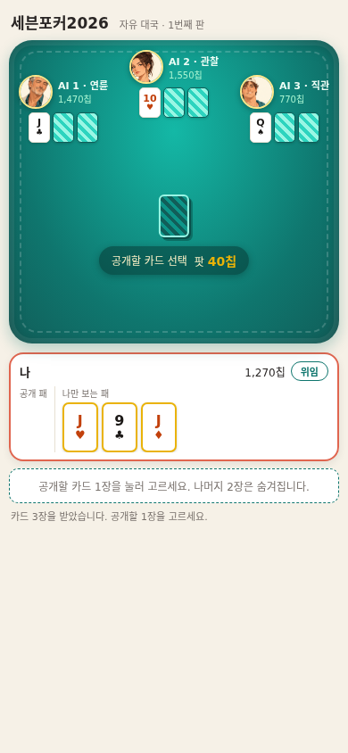
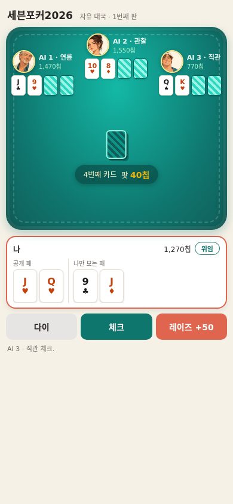

# 세븐포커2026

휴양지 소셜클럽 분위기의 한국식 세븐포커. 메뉴에서 자유 대국·스토리·토너먼트를 골라 플레이합니다. 실제 돈·구매·현금 보상은 없으며 가상 칩만 사용합니다.

'맞고2026 : 패담'(https://github.com/sigco3111/gostop2026)의 개발 자산(Vite+TypeScript, 단위·접근성·수용 테스트 스크립트 흐름, 모바일 우선 설계)을 바탕으로 하되, 세계관과 인물은 계승하지 않습니다.

## 현재 상태

메뉴 + 자유 대국 + 스토리 + 토너먼트(선셋 컵) 공개 중입니다.

- 게임 하기: https://sigco3111.github.io/sevenpoker2026/
- 모바일 우선 화면(390x844 한 화면 구성), PC 브라우저에서도 동작합니다. 320px 폭까지 상대 공개 패 4장의 랭크·무늬 식별을 유지합니다(뒷면 패는 구획을 분리해 중앙 팟을 가리지 않습니다).
- 자유 대국의 진행 상황(칩·판 번호)은 이 브라우저(localStorage)에만 저장됩니다. 스토리는 열린 챕터만, 토너먼트는 도달 스테이지·우승 여부만 각각 별도 키에 저장하며 세 저장은 섞이지 않습니다.

## 실행 화면

| 시작(공개 카드 선택) | 4번째 카드 베팅 |
| --- | --- |
|  |  |

실제 배포 주소에서 촬영한 화면입니다(390x844).

## 현재 범위

- 세 가지 모드: 자유 대국(제한 없는 연속 대국, 진행 저장) / 스토리 '리조트 클럽의 초대' 3챕터 / 토너먼트 '선셋 컵' 3스테이지
- 대국 진행: 4인 테이블에서 패 받기 → 베팅 → 승부 공개 → 다음 판
- 위임: 귀찮을 때 '위임'을 켜면 AI가 내 자리를 대신 플레이하고, '직접 하기'로 언제든 복귀합니다. 위임 중에는 내 자리에 '위임 중' 표시가 붙습니다.
- 테이블 연출: 펠트 테이블에 상대 3인이 앉아 있고, 중앙 덱에서 각 자리로 카드가 날아가며, 새 공개 카드는 뒤집히면서 나타납니다. 승부 공개 뒤 승자 자리는 금색으로 빛납니다.
- AI 캐릭터: 연륜(신중)·관찰(균형)·직관(공격)이 서로 다르게 플레이하고 상황에 맞는 대사 한 줄을 보여 줍니다(이름·성향·대사는 미확정 제안). AI는 자기 패와 상대의 공개 패만 보고 판단합니다(상대 히든 패는 보지 않음 — 테스트로 검증).
- 칩·판 번호는 이 브라우저(localStorage)에만 저장됩니다.
- 저장 형식: 판이 끝난 시점의 잔고·판 번호·탭 소유권을 하나의 버전 붙은 레코드(sevenpoker2026.save2)로 저장합니다. 판 도중에는 저장하지 않습니다(마지막으로 완료된 판의 잔고에서 새 판이 시작됩니다).
- 여러 탭에서 열면: 한 탭의 기록만 저장되고, 다른 탭이 같은 판을 먼저 저장했거나 더 앞선 판이면 뒤처진 탭의 저장을 막고 안내를 표시합니다. 이 판정은 Web Locks로 직렬화됩니다. Web Locks를 지원하지 않는 브라우저에서는 직렬화를 보장할 수 없어, 다른 탭의 기록이 보이는 순간 그 탭의 저장을 막는 보수적 차단으로 동작합니다. 이 경로는 완전한 충돌 방지가 아니며, 두 탭이 거의 동시에 처음 저장하는 경쟁은 남습니다. 그래서 지원하지 않는 브라우저에서는 게임 시작부터 "여러 탭의 동시 저장을 보호하지 못하므로 한 탭에서만 플레이해 달라"는 안내를 항상 표시하고, 차단이 걸린 뒤에는 별도의 경고를 표시합니다.

## 채택 규칙

세븐포커는 서비스마다 변형이 커서 특정 표준 룰과 같다고 보지 않으며, 아래 채택안을 이 저장소에 명시합니다(패담과 같은 방식).

### 확정 (대화에서 사용자가 직접 확인)

- 종목: 한국식 세븐포커(텍사스 홀덤 아님)
- 테이블: 4인 — 사용자 본인 + AI 3명
- 첫 버전: 자유 대국만. 시나리오·토너먼트는 후속 버전 → 2026-11-12 17:45:13 KST 사용자 요청(WhatsApp wamid.HBgMODIxMDcyODk3NTA5FQIAEhgUM0I2NUNGNzQwMjE2MENGNzFCNEIA)으로 스토리/토너먼트/메뉴 일러스트/캐릭터 추가가 범위에 포함됨(스토리·토너먼트 모두 공개 완료)
- 머니: 가상 칩만. 현금 결제 없음. 파산하면 기본 칩을 다시 지급하고 계속 플레이
- 분위기: 밝고 경쾌한 휴양지 소셜클럽 톤(크림 바탕, 청록 테이블, 산호·노랑 포인트)
- 세계관: 새 세계관. 패담 누아르의 인물을 계승하지 않음
- 위임 기능: 도입. 켜 두면 직접 돌아올 때까지 계속 대리. 위임 중 표시 + '직접 하기' 복귀 조작 포함
- 올인 정산: 기여금 구간별로 메인팟·사이드팟을 나눠 정산(2026-11-12 사용자 위임 확정). 적게 걸고 올인한 사람은 자기 기여금 구간까지만 받고, 초과분은 남은 사람 중 차점자에게. 다이한 사람의 기여금은 팟에 남지만 수상 자격은 없음. 아무도 못 받은 미콜 베팅은 수상이 아니라 본인(기여자)에게 반환되며 결과 문구에 '미콜 베팅 N칩 반환'으로 별도 표시

### 제안 기본값 (사용자 미확정 — 검증용으로 구현된 임시값)

- 진행: 카드 3장 중 1장을 골라 공개하고 시작(버리기 없음). 4~6번째는 공개로 받으며 매번 베팅, 7번째는 히든으로 받고 마지막 베팅 뒤 승부 공개
- 판정: 일반 족보 → 같은 족보는 숫자 → 그다음 무늬 서열(스페이드 > 다이아 > 하트 > 클로버, 이른바 스다하크)
- 앤티 10칩, 시작 칩 1,500, 파산 리필 1,000칩
- 베팅 단위: 4·5구 50칩, 6·7구 100칩 / 스트리트당 레이즈 최대 2회
- 팟 분할: 무늬 서열로 동률을 해소하므로 단독 승자가 팟을 가짐
- 자동 다이(시간 제한) 없음
- AI 캐릭터 성향 수치·대사 문구는 임시안. 성향 차이는 1,500판 시뮬레이션으로 검증(다이: 연륜 24.9% > 관찰 20.0% > 직관 11.0% / 레이즈: 직관 34.8% > 관찰 19.4% > 연륜 11.8%)
- 캐릭터 명부 6인(이름·역할·아바타): 소연(연륜)·선우(관찰)·록키(직관)·하루(딜러)·미로(계산)·번개(승부). 자유 대국 상대는 기존 3인(소연·선우·록키) 유지
- 스토리 '리조트 클럽의 초대' 3챕터: 챕터별 상대 조합·시작 칩(1500/2000/2500)·목표 칩(2000/2600/3200)·장면 대사는 임시안. 목표 달성 시 다음 챕터 개방, 파산(앤티 미만) 시 해당 챕터 재도전
- 스토리 진행 저장: 열린 챕터 번호만 sevenpoker2026.story1에 저장. 대국 중 칩은 저장하지 않음(챕터는 항상 시작 칩에서 개시)
- 토너먼트 '선셋 컵' 3스테이지: 예선 8판(시작 1500칩/앤티 10) → 준결승 8판(2500칩/앤티 20) → 결승 10판(3500칩/앤티 30). 각 스테이지는 정해진 판 수를 치른 뒤 칩 1위만 다음 단계로 진출하며, 결승 1위가 우승. 스테이지 구성·칩 수치는 임시안
- 토너먼트 진행 저장: 도달 스테이지·우승 여부만 sevenpoker2026.tour1에 저장. 대국 중 칩은 저장하지 않음(스테이지는 항상 시작 칩에서 개시)
- 올인 콜: 칩이 부족하면 있는 만큼만 걸 수 있음(정산은 위 확정 룰의 팟 분리로 처리)

### 아직 정할 것들

- 위임 중지 요청이 진행 중 행동에 언제 적용되는지(현재: 손에 든 조작은 즉시, AI가 진행 중인 판은 계속)
- 위임 중 베팅 한도 설정 여부
- 자동 다이 도입 여부와 베팅 시간 제한
- 초이스·n구 등 변형 룰(첫 버전 제외 제안)
- 캐릭터 이름·성향·대사 확정

룰 출처: thepoker.co.kr 포커 교육 페이지(2026-11-12 확인). 세부 수치는 위와 같이 미확정입니다.

## 개발

```bash
npm install
npm run dev    # 로컬 실행
npm test       # 엔진 단위 테스트 + 통제 플로우 테스트
npm run build  # 타입 검사 + 빌드
```

구조: `src/engine`(카드·족보·진행·AI), `src/ui`(대국 화면), `test`(엔진 테스트 + 통제 플로우 테스트). 배포는 `docs/`를 GitHub Pages로 서빙합니다.

### 통제 플로우 테스트 (test/flow.controlled.test.ts)

게임 → 결과 → 다음 단계 연결(스토리 챕터 클리어·파산 재도전·엔딩, 토너먼트 예선 통과·탈락·결승 우승·스테이지 재진입)을 검증합니다. 검증 환경과 범위를 아래와 같이 한정합니다(실제 브라우저에서의 종단 플레이 검증이 아닙니다).

- 환경: happy-dom + 가짜 타이머. Math.random을 시드 고정 LCG로 대체해 결과를 재현 가능하게 통제합니다.
- 방식: 실제 src/main.ts를 마운트하고 실제 UI 버튼을 클릭해 진행합니다(엔진만 직접 호출하지 않음). 시드를 탐색해 원하는 결과(승/패)가 나오는 시드로 각 흐름을 검증합니다.
- 확인 항목: 결과 씬 문구, 다음 단계 인트로 이동, 진행 저장 키(story1·tour1) 값, 자유 대국 저장(save2) 불변.
- 범위 밖: 실제 브라우저 렌더링·애니메이션·네트워크·실제 기기 입력. 이들은 배포 후 라이브 화면 캡처로 별도 확인합니다.

## 라이선스와 원작 표기

- **코드**: 별도의 코드 라이선스를 아직 지정하지 않았습니다.
- **아바타 이미지**: 이 프로젝트를 위해 새로 만든 그림입니다.
- **룰 참고**: thepoker.co.kr 포커 교육 페이지(2026-11-12 확인). 세부 수치·변형은 위 채택안과 같으며, 실제 서비스마다 다른 변형이 있습니다.
- **개발 자산**: '맞고2026 : 패담'(https://github.com/sigco3111/gostop2026)의 개발 흐름(Vite+TypeScript, 테스트 스크립트, 모바일 우선 설계)을 참고했습니다.

## 패담에서 가져온 교훈

- 실제 폰 플레이테스트를 완성 판정 전 마일스톤에 둡니다(시뮬레이터 판정 금지).
- 채택 룰은 이 README에 명시합니다.
- 모바일 우선: 대국 정보와 조작을 한 화면(390x844)에서 판단할 수 있게 합니다.
